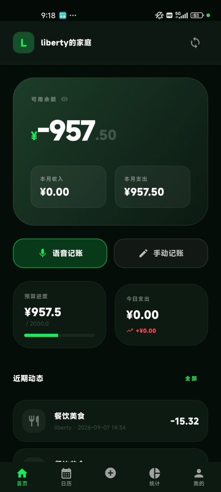
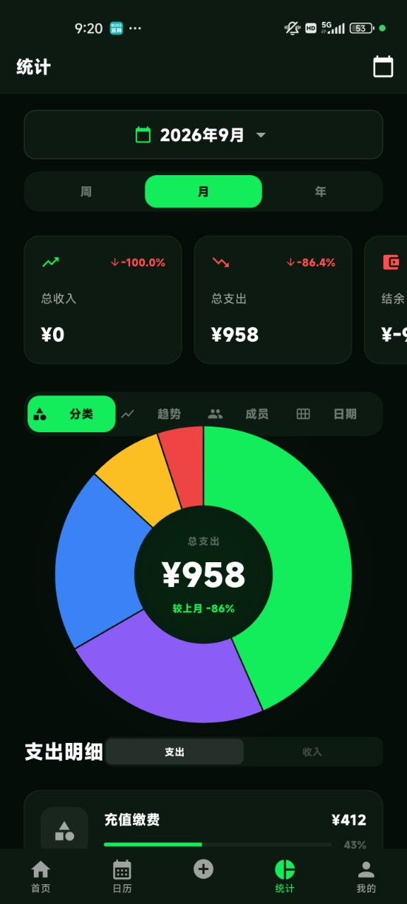
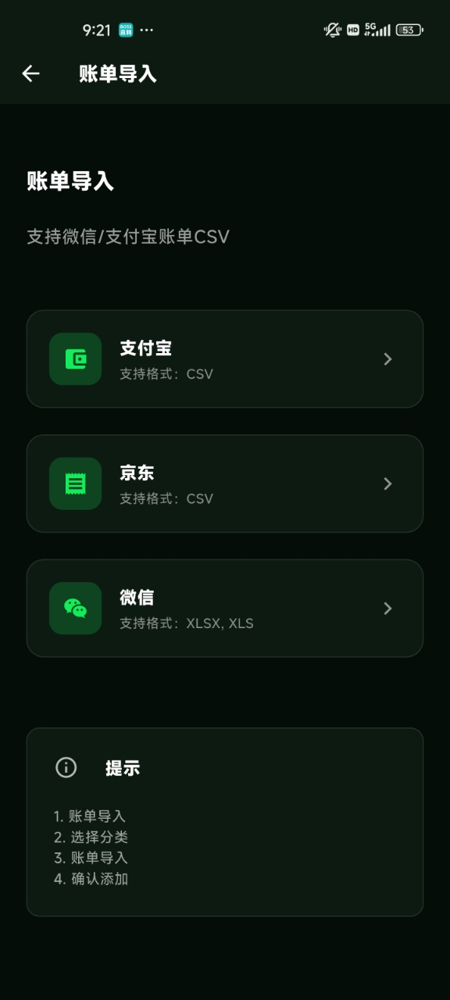
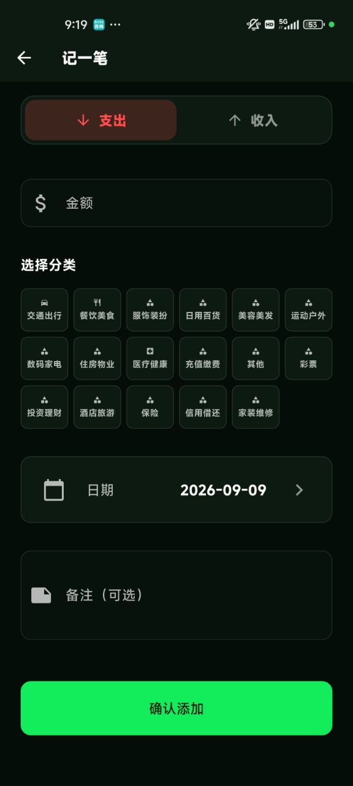
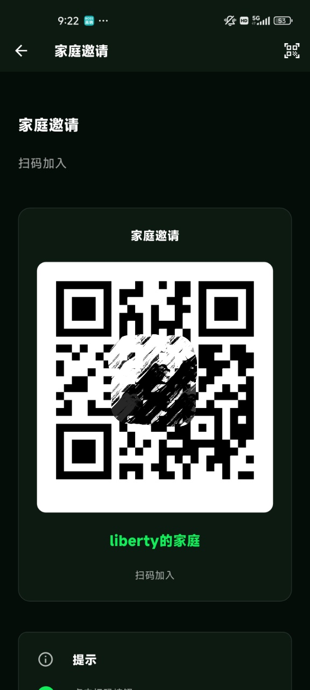

<p align="center">
  
</p>

<h1 align="center">玺记 Xiji</h1>

<p align="center">
  <b>本地优先、端到端加密的家庭记账应用</b><br/>
  账本留在你自己的设备上，一家人用密文共享
</p>

<p align="center">
  
  
  
  
  
</p>

<p align="center">
  <a href="#界面预览">界面预览</a> ·
  <a href="#为什么是玺记">为什么是玺记</a> ·
  <a href="#核心特性">核心特性</a> ·
  <a href="#数据与隐私">数据与隐私</a> ·
  <a href="#快速开始">快速开始</a> ·
  <a href="#常见问题">常见问题</a> ·
  <a href="#参与贡献">参与贡献</a> ·
  <a href="CHANGELOG.md">更新日志</a>
</p>

<p align="center">
  
  
  
</p>

<p align="center"><sub>首页 · 统计 · 账单导入</sub></p>

> A local-first, end-to-end encrypted family bookkeeping app built with Flutter.

## 为什么是玺记

- **账本属于你**：账单真身是设备上的本地 SQLite，读写不依赖网络，服务端不存明文
- **一家人一起记**：邀请家人加入家庭，各自记账后以密文同步合并；断网照记，联网自动补发
- **记账不折腾**：语音一句话记账、微信 / 支付宝 / 京东账单自动导入、分类规则自动预填、统计预算一眼看清

## 核心特性

| 模块 | 能力 |
| --- | --- |
| 记账 | 支出 / 收入、分类、日期、备注；账单全文搜索 |
| 语音记账 | 系统语音识别转文字 + 本地规则解析生成账单，不经过本项目后端 |
| 账单导入 | 微信 xlsx、支付宝 / 京东 csv（自动识别 GBK）；本地解析，分类规则引擎预填并支持学习修正 |
| 家庭协作 | 注册自动创建家庭；邀请二维码本地生成（断网可展示）、扫码申请、管理员审核、成员管理、退出、多家庭切换、成员列表离线回退 |
| 统计与预算 | 周 / 月 / 年，分类 / 趋势 / 成员 / 日期维度，本地计算；月度预算与执行进度；日历视图 |
| 账号与安全 | 手机号注册 / 登录 / 找回；双 Token 无感续期；按账号分库隔离 |
| 隐私与同步 | 本地优先；按家庭 × 成员开关的端到端加密云备份；同步失败不影响记账 |
| 个性化 | 多主题、简体 / 繁体 / 英文、字号 0.8–1.4 调节 |

## 数据与隐私

> [!IMPORTANT]
> 云备份默认关闭。开启时需设置加密口令并保存**一次性恢复码**；口令与恢复码同时丢失，云端密文将无法解密。

- **数据在哪**：账单写入本地 SQLite，按账号分库（`xiji_{userId}.sqlite`），登出保留、回登复用
- **怎么加密**：AES-256-GCM 加密记录；家庭数据密钥经成员 X25519 公钥分发；加密口令经 Argon2id 派生包裹密钥
- **服务端能看到什么**：手机号、家庭关系、成员公钥、密文的写入时间与大小
- **服务端看不到什么**：金额、分类、备注及任何账本内容。同步只发生在开启加密备份之后，未开启时数据只在本机
- **边界说明**：端到端加密保护的是内容，服务端仍可观察同步元数据（频率、记录大小），这是自托管备份的固有取舍

## 界面预览

| 首页 | 记一笔 | 统计 | 家庭邀请 | 账单导入 |
| :---: | :---: | :---: | :---: | :---: |
|  |  |  |  |  |

## 快速开始

### 前置条件

- Flutter SDK 3.x（Dart 3）
- Android Studio 或 VS Code + Android SDK
- 账号与家庭功能需要可用的后端（默认 `http://127.0.0.1:8089/api`）；登录后记账数据存本地，断网可用

### 运行

```bash
git clone https://github.com/liberty-ask/xiji_flutter.git
cd xiji_flutter
flutter pub get
flutter run
```

```bash
# 修改 drift 表结构或 l10n 文案后重新生成代码
dart run build_runner build --delete-conflicting-outputs

# 运行测试
flutter test
```

> [!TIP]
> 后端怎么起？见 [xiji 后端仓库](https://github.com/liberty-ask/xiji)。只有账号登录、家庭协作与加密同步需要它，本地记账不依赖后端。

<details>
<summary><b>配置 API 地址与打包</b></summary>

API 地址在 [`lib/services/api/api_client.dart`](lib/services/api/api_client.dart) 中按编译模式切换：

- **Debug**：`http://127.0.0.1:8089/api`
- **Release**：同一文件中的正式环境地址，按你的部署修改

真机调试时把 `127.0.0.1` 改成电脑局域网 IP，并保证手机与后端同一网络。

```bash
flutter build apk
flutter build appbundle
```

> master 分支使用原生 SQLite（`dart:io`），不支持 Web 构建；`web/` 目录与 `build_web.*` 为云端版历史遗留，Web 版见 `online` 分支。iOS 工程目录未随仓库提交，可自行 `flutter create --platforms=ios .` 生成后构建（未经官方验证）。

</details>

## 版本选择

| 分支 | 版本 | 数据存储 | 适合 |
| --- | --- | --- | --- |
| `master`（默认） | 本地加密同步版 | 本地 SQLite 为数据真身；可选端到端加密云备份（默认关闭） | 隐私优先、家庭共享、离线可用 |
| `online` | 云端版 | 自部署服务端（配对后端 `online-final` tag），支持 Web | 多设备实时共享、浏览器使用 |

> 两个分支数据模型不同，请勿混用后端。

## 常见问题

<details>
<summary><b>服务端能看到我的账本吗？</b></summary>

不能。服务端只保存密文与同步元数据，密钥只在设备上生成与保存。详见[数据与隐私](#数据与隐私)。
</details>

<details>
<summary><b>忘记加密口令怎么办？</b></summary>

用设置口令时生成的一次性恢复码找回。若口令与恢复码都已丢失，需要重置加密密钥，重置前的云端密文无法解密；本机数据不受影响。
</details>

<details>
<summary><b>不开云备份，家人能看到我记的账吗？</b></summary>

不会。家庭协作（邀请、审核、成员管理）仍需联网，但账本数据不会同步给其他成员。
</details>

<details>
<summary><b>换手机怎么迁移？</b></summary>

新设备登录同一账号，指向同一后端，输入加密口令完成解锁后，会从云端全量拉取并解密重建本地账本。
</details>

<details>
<summary><b>支持 Web / iOS 吗？</b></summary>

master 的本地库依赖原生 SQLite，仅支持 Android。Web 见 `online` 分支；iOS 需要自行生成工程目录后构建。
</details>

## 项目结构

```
lib/
├── config/       路由
├── crypto/       密钥库、加密原语（AES-256-GCM / X25519 / Argon2id）
├── data/local/   本地 SQLite（drift）、各 Repository、全文搜索
├── models/       数据模型
├── parser/       微信 / 支付宝 / 京东账单解析
├── providers/    状态管理
├── screens/      页面（记账、统计、家庭、导入、设置…）
├── services/     API 客户端与业务门面
├── sync/         发件箱、拉取、调度、备份开关
├── utils/        工具与常量
├── widgets/      通用组件
└── l10n/         简中 / 繁中 / 英文
```

## 技术栈

<details>
<summary><b>依赖一览</b></summary>

| 技术 | 版本 | 用途 |
| --- | --- | --- |
| Flutter / Dart | 3.x | 跨平台 UI |
| Provider | ^6.1.1 | 状态管理 |
| GoRouter | ^13.0.0 | 路由 |
| Dio | ^5.4.0 | HTTP（双 Token 无感刷新） |
| drift / sqlite3_flutter_libs | >=2.31.0 <2.32.0 | 本地 SQLite、全文搜索 |
| cryptography / pointycastle | ^2.7.0 / ^3.9.1 | AES-256-GCM、X25519、Argon2id |
| SharedPreferences | ^2.2.2 | 本地偏好 |
| Flutter Secure Storage | ^9.0.0 | Token 与密钥 |
| fl_chart | ^0.65.0 | 统计图表 |
| speech_to_text | ^7.3.0 | 语音识别 |
| qr_flutter / mobile_scanner | ^4.1.0 / ^5.2.3 | 邀请码与扫码 |
| file_picker / image_picker | ^8.1.2 / ^1.0.7 | 账单文件与头像 |
| excel / fast_gbk | ^4.0.6 / ^1.0.0 | xlsx、GBK csv 解析 |
| cached_network_image | ^3.4.1 | 头像磁盘缓存 |
| intl / flutter_localizations | — | 多语言 |

</details>

## 参与贡献

欢迎 Issue 与 PR。流程：

1. Fork 本仓库并新建分支（`feat/xxx` 或 `fix/xxx`）
2. 提交前运行 `flutter analyze` 与 `flutter test`
3. 向 `master` 发起 Pull Request，说明动机与验证方式

涉及密钥或数据安全的问题，请勿公开提交 Issue。

## 相关仓库

GitHub 为源仓库；Gitee 为同步镜像，内容以 GitHub 为准。

| 端 | GitHub（源仓库） | Gitee（同步镜像） |
| --- | --- | --- |
| 前端（本仓库） | [liberty-ask/xiji_flutter](https://github.com/liberty-ask/xiji_flutter) | [liberty-warehouse/xiji_flutter](https://gitee.com/liberty-warehouse/xiji_flutter) |
| 后端 Spring Boot | [liberty-ask/xiji](https://github.com/liberty-ask/xiji) | [liberty-warehouse/xiji](https://gitee.com/liberty-warehouse/xiji) |

## 致谢

感谢 Flutter、[drift](https://drift.simonbinder.eu/)、[cryptography](https://pub.dev/packages/cryptography)、[fl_chart](https://github.com/imaNNeo/fl_chart) 等开源项目。

## 许可证

[MIT License](LICENSE)。可商用、可修改、可再分发，需保留版权与许可声明。

---

<p align="center"><sub>玺记 — 温馨家庭，共同记账</sub></p>
